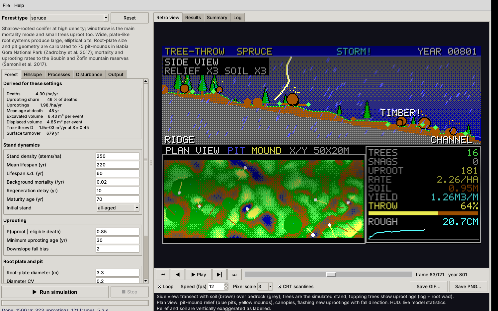
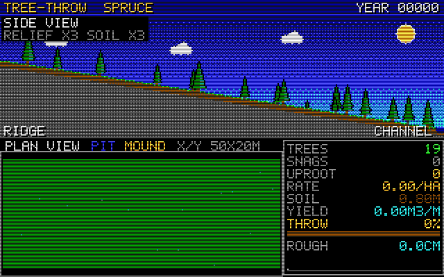

# TreeThrow.py — tree-throw hillslope evolution model

A plan-view (x downslope, y across-slope) landscape evolution model for a single
ridge-to-channel hillslope. Soil moves by **background diffusion** and by
**tree throw**. The tree-throw rates come from an individual-based forest whose
species set its lifespan, stand density, uprooting share of mortality and
root-wad (root-plate) size.

```bash
python TreeThrow.py --list-species                       # parameter table
python TreeThrow.py --species pine --length 60 --width 30 --slope 0.4
python TreeThrow.py --species aspen --slope-deg 25 --years 3000
python TreeThrow.py --compare --length 50 --width 20 --slope 0.35   # all four species
python TreeThrow.py --species deciduous --no-tree-throw   # diffusion-only control
python TreeThrow.py --species pine --disturbance fire --first-disturbance 300 --years 600
python TreeThrow.py --species spruce --disturbance windstorm --disturbance-interval 200 --disturbance-severity 0.3
python TreeThrow.py --species-file my_species.json        # custom species
```

Requires `numpy` and `matplotlib` (`scipy` is optional). Runs headless (Agg backend).

## Graphical interface and retro animation

```bash
python TreeThrowGUI.py                                       # GUI
python TreeThrowRetro.py --species spruce --years 1500 \
    --disturbance windstorm --disturbance-interval 150 --gif storms.gif   # animation only
```

The GUI needs tkinter. It is included with the python.org and conda builds; on Debian or Ubuntu install it with `sudo apt install python3-tk`.



**Left: parameters, in tabs.**

* **Forest**: species preset, stand dynamics, uprooting, and root plate and pit. A *Derived* box shows the deaths, uprooting rate and share, event volumes and expected tree-throw diffusivity implied by the current settings.
* **Hillslope**: geometry, run length and seed, soil and bedrock. A *Run size* box estimates the run time.
* **Processes**: creep, tree-throw mechanics, pit-mound collapse and root cycling.
* **Disturbance**: fire or windstorm regime, with presets.
* **Output**: animation frames, pixel scale, CRT scanlines and results folder.

Hover over any field for an explanation. Use File → Load/Save species JSON for custom species. **Run** starts the simulation in the background with a progress bar, and **Stop** ends it early and keeps what has been simulated.

**Right: results.**

* **Retro view**: a 320 × 200, 16-colour EGA pixel animation of the run. Play, pause, step or scrub through it, change speed, pixel scale and scanlines, and export a GIF or a PNG frame.
* **Results**: the eight-panel scientific figure.
* **Summary**: key numbers from the run.
* **Log**: messages.

**What the retro view shows.** Everything comes from the simulation:

* **Side view**: the hillslope transect through the middle of the plot, with soil (brown) over bedrock (grey). Pit-mound relief and soil are vertically exaggerated by the factor shown. The trees are the simulated stand at their simulated sizes, with far trees drawn darker. An uprooting appears as a toppling log and upturned root wad, falling the way the tree fell.
* **Fire**: a red sky, burning snags, then snags toppling over the following years.
* **Windstorm**: rain and lightning, "TIMBER!", and a burst of uprootings.
* **Plan view**: pit-mound relief from blue pits to yellow mounds, tree canopies, snags, and new uprootings flashing with a line along their fall direction.
* **HUD**: live trees, snags and uprootings; uprooting rate; mean soil depth; sediment yield; tree-throw share of the downslope flux; and a roughness graph.

Frames are spaced evenly over the run. Extra frames are always captured at each fire or storm and in the decades after it.



## Processes

| Process | Formulation |
|---|---|
| Background diffusion | `q = -D grad z` (linear) or `D / (1 - (S/Sc)^2)` (nonlinear, `--transport nonlinear`); scaled by `1 - exp(-h/h*)` when soil is tracked |
| Stand dynamics | Every tree has a position, an age, a lifespan drawn from N(mean, sd), and a mature root-plate diameter and depth drawn from lognormals with negative correlation (`size_depth_correlation`; wide plates are shallow, Zadrożny et al. 2017). Diameter grows as `1 - exp(-3 age / maturity_age)`; depth grows three times faster. Dead trees are replaced after an exponential regeneration delay, so stand density stays constant. |
| Mortality | Trees die at their senescence lifespan or earlier, with a constant annual background probability (`background_mortality`), so small trees die too (Šamonil et al. 2017; Gabet & Mudd 2010). Stand density is held exactly at the species value. |
| Uprooting | Trees younger than `min_uproot_age` snap or die standing (Gabet & Mudd 2010: 80 yr for Douglas fir). Older trees uproot with probability `uproot_fraction`. The rest snap or die standing and move no soil. |
| Disturbance (optional) | `--disturbance windstorm`: storms kill a share of trees, preferentially large ones (Constantine et al. 2012), and most uproot. `--disturbance fire`: fire kills trees standing; snags topple at `snag_fall_rate` and their root plates decay over `root_decay_time` (Gallaway et al. 2009). Events recur at `disturbance_interval` (exponential waiting time) or once at `first_disturbance`. Off by default. |
| Fall direction | von Mises. Its mean vector is `fall_slope_bias * (local gradient over ~2R)` plus an optional wind vector (`--wind-dir`, `--wind-kappa`). |
| Pit | Flat-floored bowl with depth profile `H (1 − ρⁿ)` (`pit_shape_exponent`, default n = 4, which has the volume of a half-ellipsoid; n = 2 is a paraboloid), equivalent radius R, `pit_aspect` (default 1.5) times wider across the fall line than along it. It is limited by soil thickness, and a fraction (`bedrock_pluck_fraction`) of root penetration below the soil plucks bedrock. That rock becomes soil, dilated by `rho_r/rho_s`. |
| Mound | The root plate rotates about a hinge at the pit edge. Soil is deposited as an elliptical mound as long as the pit, centred `a + c(n) H` from the stump along the fall line (a = semi-axis along the fall line; c = depth of the excavated soil's centroid, 0.4 H for n = 4). |
| Infill | A fraction of root-plate soil falls back into the pit: `f0 (1 - S_fall / S_crit)`, clipped to 0–0.95. `S_fall` is the ground gradient along the fall direction, `f0 = 0.3` (`--infill`) and `S_crit = tan 47°` (Norman et al. 1995, secondary). Downslope falls shed more soil away from the pit, so displaced volume grows with slope. |
| Pit-mound collapse | Pit, mound and a 0.5 m margin are marked as fresh soil. The rate is scaled per species (`fresh_collapse_scale`; 0.4 for deciduous). This soil diffuses with an extra `D_f exp(-age/τ)`, D_f = 0.20 m²/yr and τ = 3 yr (`--fresh-diffusivity`, `--fresh-decay-time`), calibrated to the 1–5 yr spruce chronosequence of Zadrożny et al. (2017). The collapse acts on relief relative to the surrounding surface, inside a window with no-flux borders, so it conserves volume. |
| Thin soils | Where soil is thinner than 0.5 m, root plates are shallower, down to half depth on bare rock (Gabet & Mudd 2010). |
| Root cycling (optional) | `--root-cycle` adds the diffusivity of soil moved by root growth and decay (Hoffman & Anderson 2013): roots follow `Y = 1 − β^(100z)`, and only roots in the A horizon lift the surface. Off by default, because the background diffusivity already includes it with other creep. |
| Soil production | `P = P0 exp(-h/h0)` |
| Boundaries | Ridge (x = 0): no flux; soil thrown over the divide is mirrored back (symmetric divide). Channel (x = L): fixed or lowering elevation, removes all sediment delivered to it. Lateral boundaries are periodic. |

## Species parameter sets

| Parameter | pine | deciduous | aspen | spruce |
|---|---|---|---|---|
| Mean lifespan (yr) | 200 ± 60 | 250 ± 75 | 90 ± 25 | 220 ± 60 |
| Stand density (stems/ha) | 350 | 280 | 1100 | 250 |
| Background mortality (/yr) | 0.003 | 0.005 | 0.010 | 0.020 |
| Minimum uprooting age (yr) | 80 | 80 | 20 | 30 |
| P(uproot \| eligible death) | 0.19 | 0.40 | 0.25 | 0.85 |
| Mature root-plate diameter (m) | 2.4 | 2.85 | 1.5 | 3.3 |
| Mature root-plate depth (m) | 1.0 | 0.75 | 0.5 | 1.4* |
| Pit width / length | 1.5 | 1.5 | 1.5 | 1.54 |
| Size–depth correlation | −0.6 | −0.6 | −0.6 | −0.8 |
| Maturity age (yr) | 80 | 100 | 40 | 70 |
| Regeneration delay (yr) | 10 | 5 | 2 | 10 |
| → Deaths (/ha/yr) | 2.2 | 1.9 | 18 | 4.3 |
| → Uprooting share of deaths | 15 % | 26 % | 20 % | 46 % |
| → Uprootings (/ha/yr) | 0.32 | 0.52 | 3.8 | 2.0 |
| Fresh-collapse rate scale | 1 | 0.4 | 1 | 1 |
| → Mean displaced volume (m³) | 2.1 | 2.2 | 0.40 | 4.7 |
| → Expected tree-throw D at S = 0.35, uprooting only (m²/yr) | 1.1e-4 | 2.0e-4 | 1.4e-4 | 1.9e-3 |

\*Root-plate thickness. About 17 % of the soil falls straight back on a 25° slope, leaving a 1.16 m open pit. Collapse brings it to the observed 0.95 m within a year.

* **Spruce**: the pit depth, volume, shape, 1–5 yr degradation and size–depth correlation come from 75 uprooted Norway spruce in Babia Góra (Zadrożny et al. 2017). Mortality, uprooting share and rate come from the Boubín and Žofín mountain reserves (Šamonil et al. 2017).
* **Deciduous**: root-plate size gives a displaced volume of 2.2 m³, near beech and old-growth values of 2.4–2.8 m³. Pit-mounds collapse at 0.4× the spruce rate, which matches Doane's 5–10 yr couplets and the Harvard Forest relief of young couplets. Mortality, uprooting share (~27 %) and rate (~0.5 /ha/yr) follow Šamonil's lowland and highland reserves. Together they give an 11–18 % tree-throw share of hillslope flux, as Doane et al. (2021) measured for southern-Indiana hardwoods.
* **Pine**: mortality, topple share (15 %) and minimum topple age (80 yr) follow Gabet & Mudd's (2010) Douglas-fir parameters. Root-plate size remains an estimate.
* **Aspen** remains an estimate; no aspen-specific data were available.

These are representative, literature-informed values in round numbers. Calibrate
them against stand inventories and pit-mound surveys before applying them to a
real site. Override any value from the command line (`--density`, `--lifespan`,
`--root-diameter`, `--root-depth`, `--uproot-fraction`). For a completely new
species, supply a JSON file whose keys match the `TreeSpecies` fields.

## Outputs

For each species, in `--output/<species>/`:

* `hillslope_evolution.png`: final hillshade with pit-mound relief, elevation
  change, soil thickness, fall-azimuth rose, profile evolution, the
  tree-throw vs. diffusion flux split, and roughness.
* `events.csv`: every uprooting (time, location, root-plate size, azimuth,
  excavated and displaced volume, volume exported to the channel).
* `summary.json`: configuration, mean fluxes by process (uprooting,
  pit-mound collapse, background diffusion), the emergent tree-throw
  diffusivity (`q_tt / S`) next to its Monte-Carlo analytic expectation,
  sediment yield, and soil produced by root plucking.
* `final_state.npz`: elevation, soil and bedrock grids.

`--compare` also writes `species_comparison.png` and `comparison_summary.json`.

## Checks

`python -m pytest tests/test_tree_throw.py` checks:

* volume conservation per event, including bedrock dilation, channel export and the mirrored divide;
* the diffusion volume balance and the linear flux `D·S`;
* the nonlinear flux enhancement and convex crest formation;
* simulated vs. analytic tree-throw diffusivity and event rate;
* elliptical, flat-floored pits, slope-dependent infill and the size–depth anticorrelation;
* background mortality and minimum uprooting age against the analytic stand rates;
* size-selective windstorms, fire snags with decaying root plates, and thin-soil root plates;
* the root-cycle flux formula against Hoffman & Anderson's (2013) published values;
* volume conservation, smoothing and switch-off of fresh pit-mound collapse;
* seed reproducibility and the CLI.

## Literature validation

`python validation/run_validation.py` takes about 3 minutes on 4 cores; use `--quick` for a smoke test. It compares the model with:

* pit-mound volumes and slope dependence;
* uprooting rates;
* flux shares and magnitudes;
* pit-mound cover, mound persistence and topographic roughness.

These sources were read in full:

* Zadrożny et al. (2017) and Doane et al. (2021) (`validation/zadrozny.py`, `validation/doane.py`);
* Šamonil et al. (2017), Gabet & Mudd (2010), Constantine et al. (2012) and Hoffman & Anderson (2013) (`validation/forest_papers.py`);
* the Harvard Forest HF320-03 data summary (`validation/forest_papers.py`).

Gallaway et al. (2009) was read from its abstract and introduction only. The remaining benchmarks come from abstracts and search summaries and are marked *secondary*. Results, figures, the benchmark list and a comparison with the previous model version are in [`validation/results/VALIDATION_REPORT.md`](validation/results/VALIDATION_REPORT.md).
