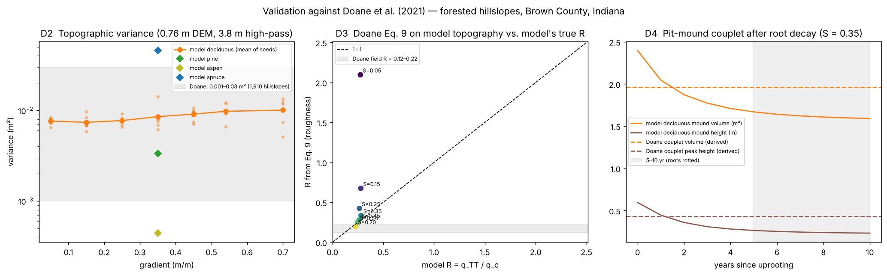

# TreeThrow.py — validation results

Generated by `validation/run_validation.py` in 1.9 min. Figures: `validation_summary.png`; data: `validation_results.json`.

> **Benchmark caveat.** Zadrożny et al. (2017) (Z rows) and Doane et al. (2021) (D rows, V3) were read from the full papers. Every other benchmark comes from abstracts or search summaries (status *secondary*) because the publishers' websites could not be reached; check them against the original papers before relying on those verdicts.

## Scorecard

| Test | Benchmark | Model | Verdict |
|---|---|---|---|
| V0 internal: simulated / analytic D_tt (pine) | 1.0 | 0.94 ± 0.07 (SE) | PASS |
| V0 internal: simulated / analytic D_tt (deciduous) | 1.0 | 0.85 ± 0.10 (SE) | PASS |
| V0 internal: simulated / analytic D_tt (aspen) | 1.0 | 0.95 ± 0.05 (SE) | PASS |
| V0 internal: simulated / analytic D_tt (spruce) | 1.0 | 0.93 ± 0.06 (SE) | PASS |
| V1 mean displaced volume (deciduous) | 2.8 m³ (Boubín) | 2.50 m³ | PASS |
| V1 mean displaced volume (pine) | 2.8 m³ (Boubín) | 1.56 m³ | PASS |
| V1 mean displaced volume (spruce) | 2.8 m³ (Boubín) | 4.63 m³ | FAIL |
| V1b deciduous vs. Sudetes beech root plates | 2.4 m³ (Pawlik 2016) | 2.50 m³ (×1.04) | PASS |
| V1b deciduous vs. Carpathian root plates | 2.2–3.35 m³ | 2.50 m³ | PASS |
| V1b pine vs. Sudetes spruce site means (conifer proxy) | 0.4–4.2 m³ (Pawlik 2016) | 1.56 m³ | PASS |
| V1b pine vs. 40 cm DBH spruce (unconfirmed review value) | 1.0 ± 0.25 m³ | 1.56 m³ (×1.6) | N/A — contradicted by primary spruce data (Z1) |
| V2 event volume increases with slope | yes (Norman 1995; Gallaway 2009; Zadrożny 2017) | +22 % per unit gradient | PASS |
| V2 tree-throw flux increases with slope | yes | +252 % per unit gradient | PASS |
| V3 tree-throw share of flux (deciduous, S = 0.35) | 11–18 % (Doane 2021, primary) | 17 % | PASS |
| V4 flux within 10× of Constantine 2012 (pine) | 2×10⁻⁴ m²/yr | 4.3e-05 m²/yr | PASS |
| V4 flux within 10× of Constantine 2012 (deciduous) | 2×10⁻⁴ m²/yr | 7.0e-05 m²/yr | PASS |
| V4 flux within 10× of Constantine 2012 (aspen) | 2×10⁻⁴ m²/yr | 2.6e-05 m²/yr | PASS |
| V4 flux within 10× of Constantine 2012 (spruce) | 2×10⁻⁴ m²/yr | 4.4e-04 m²/yr | PASS |
| V4 tree throw ≈ 1 % of creep (deciduous) | ≤ ~1–3 % (Gallaway 2007/2009) | 21 % | FAIL |
| V5 uprooting rate (deciduous) | 1.5 /ha/yr (Razula) | 0.48 /ha/yr | FAIL |
| V5 uprooting rate (spruce) | 1.5 /ha/yr (Razula, mixed beech–fir–spruce) | 1.35 /ha/yr | PASS |
| V5 pit-mound cover at Razula rate | > 14 % | 39 % (>10 cm relief) | PASS |
| V6 persistence of a 50 cm mound (to < 5 cm), default D | 200–250 yr (Jura) | 1499 yr (fresh mound halves in 4 yr) | FAIL |
| Z1 spruce pit depth at 1 yr (calibrated) | 0.95 ± 0.09 m | 0.91 m | PASS |
| Z1 spruce pit volume at 1 yr (calibrated) | 4.3–5.8 m³ | 4.59 m³ | PASS |
| Z1 spruce pit length / width at 1 yr | 2.74 / 4.23 m | 3.00 / 5.00 m | PARTIAL |
| Z2 sign of size–depth correlation (spruce) | r = -0.80 (Fig. 3) | r = -0.77 | PASS |
| Z2 sign of size–depth correlation (pine) | r = -0.80 (Fig. 3) | r = -0.56 | PASS |
| Z2 sign of size–depth correlation (deciduous) | r = -0.80 (Fig. 3) | r = -0.56 | PASS |
| Z3 soil dislocation increases with slope | yes (RDA, Fig. 4) | +22 % per unit gradient | PASS |
| Z4 spruce pit depth at 3 / 5 yr | 0.65 / 0.52 m | 0.65 / 0.57 m | PASS |
| Z4 spruce mound height at 1 / 3 / 5 yr | mineral 0.71 / 0.42 / 0.44 m; +organic 1.04 / 0.74 / 0.82 m | 0.91 / 0.66 / 0.57 m | PARTIAL |
| D1 tree-throw share of flux (deciduous, S = 0.35) | 11–18 % (Doane 2021, primary) | 17 % | PASS |
| D2 topographic variance, deciduous, S = 0.15–0.54 | 0.001–0.03 m² | 0.0074–0.0098 m² | PASS |
| D2 variance increases with slope | yes (Fig. 4b) | +74 % per unit gradient | PASS |
| D3 Doane Eq. 9 on model DEM vs. model's true R (S = 0.25–0.54) | ratio 1 | 1.21 | PASS |
| D4 couplet mound volume at 7 yr (deciduous) | ≈ 2.0 m³ (derived) | 1.62 m³ | PASS |
| D4 couplet mound height at 7 yr (deciduous) | ≈ 0.43 m (derived) | 0.25 m | PARTIAL |
| D4 couplet length / width φ | 0.83 (Doane); 0.65 (Zadrożny pits) | 0.67 | PASS |

## Change from the previous model

Baseline: the model and suite before the root-plate, infill and pit-mound-collapse changes (`baseline_results.json`). Pit depth after 3 / 5 yr is shown relative to the 1-yr pit.

| metric | literature | previous model | updated model |
|---|---|---|---|
| V1 mean displaced volume, deciduous (m³) | ≈ 2.4–2.8 | 3.59 | 2.50 |
| V1 mean displaced volume, pine (m³) | ≈ 2.8 | 2.47 | 1.56 |
| V2 displaced volume trend with slope (% per unit gradient) | > 0 | 3 % | 22 % |
| V3 tree-throw share of flux, deciduous | 11–18 % | 19 % | 17 % |
| V4 tree-throw flux, deciduous (m²/yr) | 2×10⁻⁴ | 8.0e-05 | 7.0e-05 |
| V5 uprooting rate, deciduous (/ha/yr) | 1.5 | 0.43 | 0.48 |
| V5 pit-mound cover > 10 cm, deciduous | > 14 % | 45 % | 20 % |
| V5 pit-mound cover > 10 cm at Razula rate | > 14 % | 72 % | 39 % |
| V6 fresh mound half-height time (yr) | ≈ 2–3 (Zadrożny mound 0.71→0.42 m in 2 yr) | 240 | 4 |
| Z2 size–depth correlation, pine | −0.80 | +0.60 | -0.56 |
| V6 persistence of a 50 cm mound to < 5 cm (yr) | 200–250 | 1670 | 1499 |
| Z4 spruce pit depth at 3 / 5 yr, relative to 1 yr | 0.68 / 0.55 | 1.00 / 0.99 | 0.72 / 0.62 |

## Details

### V0 — internal consistency

The tree-throw diffusivity produced by the simulation is compared with the diffusivity computed directly from the species parameters (Monte-Carlo expectation for an infinite planar slope). Ratios per seed:

* **pine**: 1.03, 1.14, 0.82, 0.68, 1.09, 0.86
* **deciduous**: 1.03, 1.00, 0.47, 0.84, 1.06, 0.69
* **aspen**: 0.99, 1.15, 0.87, 0.88, 0.98, 0.84
* **spruce**: 1.12, 1.04, 0.83, 0.83, 1.04, 0.74

### V1 — event volume

| species | events | mean | median | 5th pct | 95th pct | within 0.1–5.6 m³ |
|---|---|---|---|---|---|---|
| pine | 1731 | 1.56 | 1.45 | 0.73 | 2.73 | 100 % |
| deciduous | 1380 | 2.50 | 2.24 | 1.03 | 4.78 | 98 % |
| aspen | 10424 | 0.31 | 0.29 | 0.14 | 0.56 | 99 % |
| spruce | 3876 | 4.63 | 4.46 | 2.68 | 7.13 | 78 % |

### V2 — slope dependence (deciduous)

| gradient | mean event volume (m³) | q_tt sim (m²/yr) | q_tt analytic | D_tt sim (m²/yr) | mean cos(fall) | tree-throw share |
|---|---|---|---|---|---|---|
| 0.05 | 2.40 ± 0.03 | 1.41e-05 | 1.25e-05 | 2.81e-04 | 0.05 | 15 % |
| 0.15 | 2.41 ± 0.03 | 4.19e-05 | 3.91e-05 | 2.79e-04 | 0.15 | 22 % |
| 0.25 | 2.46 ± 0.03 | 6.68e-05 | 6.35e-05 | 2.67e-04 | 0.24 | 21 % |
| 0.35 | 2.53 ± 0.03 | 9.92e-05 | 8.77e-05 | 2.83e-04 | 0.33 | 22 % |
| 0.45 | 2.60 ± 0.04 | 1.19e-04 | 1.10e-04 | 2.64e-04 | 0.41 | 21 % |
| 0.54 | 2.60 ± 0.04 | 1.33e-04 | 1.29e-04 | 2.46e-04 | 0.48 | 20 % |
| 0.70 | 2.77 ± 0.04 | 1.60e-04 | 1.59e-04 | 2.29e-04 | 0.57 | 18 % |

### V4 — flux magnitude

| species | q_tt (m²/yr) | D_tt (m²/yr) | q_tt / creep | q_tt / Constantine | D_tt / Constantine peak D |
|---|---|---|---|---|---|
| pine | 4.25e-05 | 1.22e-04 | 13 % | 0.21 | 0.035 |
| deciduous | 7.03e-05 | 2.01e-04 | 21 % | 0.35 | 0.057 |
| aspen | 2.56e-05 | 7.30e-05 | 8 % | 0.13 | 0.021 |
| spruce | 4.40e-04 | 1.26e-03 | 131 % | 2.20 | 0.359 |

### V5 — uprooting rate and pit-mound cover

Cover is the fraction of the hillslope whose elevation differs from a 3 m Gaussian-smoothed surface by more than the threshold.

| case | uprootings /ha/yr | cover > 5 cm | > 10 cm | > 20 cm |
|---|---|---|---|---|
| pine | 0.60 | 28 % | 9 % | 1 % |
| deciduous | 0.48 | 49 % | 20 % | 2 % |
| aspen | 3.62 | 5 % | 0 % | 0 % |
| spruce | 1.35 | 81 % | 63 % | 33 % |
| deciduous at 1.5 /ha/yr | 1.53 | 67 % | 39 % | 8 % |

### V6 — mound persistence

A single mature deciduous root plate (R = 1.75 m, H = 0.75 m) is uprooted downslope and then left to diffuse.

| D (m²/yr) | initial mound height (m) | time to half height (yr) | time to 50 cm (yr) | time to < 5 cm (yr) |
|---|---|---|---|---|
| 0.001 | 0.60 | 4 | 1 | 1500 |
| 0.01 | 0.60 | 3 | 1 | 152 |

The fresh mound first collapses quickly (fresh-soil diffusivity), then decays by background diffusion. Time for the mound to go from 50 cm to below 5 cm at D = 0.001 m²/yr: **1499 yr** (Jura benchmark 200–250 yr). Background D that would reproduce the benchmark: **6.66e-03 m²/yr**. Martin et al. (2013) inferred 0.01–0.1 m²/yr for pit-mound degradation in the Canadian Rockies.

### Z — Zadrożny et al. (2017), uprooted Norway spruce (primary data)

Source: [Zadrożny P, Halecki W, Gąsiorek M, Nicia P, Lamorski T (2017) iForest 10:783-787, doi:10.3832/ifor1959-010](https://iforest.sisef.org/contents/?id=ifor1959-010); the full text was read. Old-growth *Picea abies*, 110 yr, mean DBH 33 cm, slopes 10–40°, 75 pit-mounds surveyed 1, 3 and 5 yr after a November 2004 windstorm. The model's spruce preset and its fresh pit-mound collapse parameters were calibrated to these data, so the spruce rows of Z1 and Z4 are calibration checks; the pine and deciduous rows and Z2–Z3 are independent.

**Table 1 (mean ± SE)**

| parameter | 1 yr | 3 yr | 5 yr |
|---|---|---|---|
| pit length m | 2.74 ± 0.29 | 2.26 ± 0.05 | 2.18 ± 0.09 |
| pit width m | 4.23 ± 0.24 | 3.68 ± 0.12 | 3.28 ± 0.28 |
| pit depth m | 0.95 ± 0.09 | 0.65 ± 0.02 | 0.52 ± 0.12 |
| root plate height m | 2.35 ± 0.15 | 1.98 ± 0.34 | 1.82 ± 0.45 |
| mineral mound height m | 0.71 ± 0.22 | 0.42 ± 0.11 | 0.44 ± 0.19 |
| organic mound height m | 0.33 ± 0.09 | 0.32 ± 0.07 | 0.38 ± 0.08 |

**Z1 — pit one year after uprooting** (single mature tree falling downslope on a 25° slope). Observed pit volume implied by Table 1: 4.3–5.8 m³ (our paraboloid-to-half-ellipsoid conversion).

| model | fresh depth (m) | depth 1 yr (m) | length 1 yr (m) | width 1 yr (m) | width/length | pit volume 1 yr (m³) |
|---|---|---|---|---|---|---|
| observed spruce | — | 0.95 | 2.74 | 4.23 | 1.54 | 4.3–5.8 |
| spruce | 1.15 | 0.91 | 3.00 | 5.00 | 1.67 | 4.59 |
| pine | 0.81 | 0.47 | 2.00 | 3.50 | 1.75 | 1.29 |
| deciduous | 0.62 | 0.46 | 2.50 | 4.50 | 1.80 | 2.13 |

**Z2 — size–depth relation.** Zadrożny Fig. 3: pit depth = −0.3758 × root-plate height + 2.049 (R² = 0.64, r = -0.80). Model correlation of plate diameter and depth at death: spruce -0.77, pine -0.56, deciduous -0.56.

**Z4 — degradation.** Model spruce pit and mound (fresh collapse D = 0.15 m²/yr decaying with e-folding time 3.0 yr, plus background D = 0.001 m²/yr) against the survey. The survey is a chronosequence (different trees in each age class). The model mound contains all root-plate soil, so it is compared with both the mineral mound and mineral + organic mound.

| quantity | age (yr) | observed | model | (model − obs) / SE |
|---|---|---|---|---|
| pit depth | 1 | 0.95 ± 0.09 | 0.91 | -0.4 |
| pit depth | 3 | 0.65 ± 0.02 | 0.65 | +0.2 |
| pit depth | 5 | 0.52 ± 0.12 | 0.57 | +0.4 |
| pit length | 1 | 2.74 ± 0.29 | 3.00 | +0.9 |
| pit length | 3 | 2.26 ± 0.05 | 3.25 | +19.8 |
| pit length | 5 | 2.18 ± 0.09 | 3.25 | +11.9 |
| pit width | 1 | 4.23 ± 0.24 | 5.00 | +3.2 |
| pit width | 3 | 3.68 ± 0.12 | 6.00 | +19.3 |
| pit width | 5 | 3.28 ± 0.28 | 6.00 | +9.7 |
| mineral mound height | 1 | 0.71 ± 0.22 | 0.91 | +0.9 |
| mineral mound height | 3 | 0.42 ± 0.11 | 0.66 | +2.2 |
| mineral mound height | 5 | 0.44 ± 0.19 | 0.57 | +0.7 |
| mineral + organic mound height | 1 | 1.04 ± 0.24 | 0.91 | -0.5 |
| mineral + organic mound height | 3 | 0.74 ± 0.13 | 0.66 | -0.6 |
| mineral + organic mound height | 5 | 0.82 ± 0.21 | 0.57 | -1.2 |

Pit depth at 5 yr / 1 yr: observed 0.55, model 0.62, model without fresh collapse 0.99.

### D — Doane et al. (2021), forested hillslopes of southern Indiana (primary data)

Source: [Doane TH, Edmonds D, Yanites BJ, Lewis Q (2021) Geophys. Res. Lett. 48, e2021GL094987, doi:10.1029/2021GL094987](https://agupubs.onlinelibrary.wiley.com/doi/full/10.1029/2021GL094987); the full text was read. Tree throw accounts for 11 % (west-facing, R = 0.12) to 18 % (east-facing, R = 0.22) of hillslope sediment flux; topographic variance of 1,910 hillslopes spans 0.001–0.03 m² and increases with slope.

**D2/D3 — roughness.** Each simulated hillslope (3000 yr, 40 × 40 m) is block-averaged to 0.75 m and high-pass filtered with a 3.8 m Gaussian (our reading of the paper's "length scale of 3.8 m"), as for the lidar DEM. Doane's Eq. 9 is then applied with their fitted couplet parameters (μ_A = 0.68, σ²_A = 0.05, φ = 0.83) to estimate R from roughness, and compared with the model's true R.

Eq. 9 assumes every tree falls straight downslope, so its R grows as 1/S on gentle slopes; the model's fall direction is only weakly biased downslope there (mean cosine of fall azimuth 0.05 at S = 0.05, 0.33 at S = 0.35), so the two diverge below S ≈ 0.2.

| gradient | variance mean (m²) | range over seeds (m²) | model R = q_TT/q_c | R from Eq. 9 |
|---|---|---|---|---|
| 0.05 | 0.0076 | 0.0065–0.0083 | 0.28 | 2.10 |
| 0.15 | 0.0074 | 0.0058–0.0097 | 0.28 | 0.68 |
| 0.25 | 0.0077 | 0.0066–0.0092 | 0.27 | 0.42 |
| 0.35 | 0.0085 | 0.0061–0.0141 | 0.28 | 0.33 |
| 0.45 | 0.0091 | 0.0071–0.0107 | 0.26 | 0.28 |
| 0.54 | 0.0098 | 0.0066–0.0121 | 0.25 | 0.25 |
| 0.70 | 0.0101 | 0.0051–0.0135 | 0.23 | 0.20 |

| species (S = 0.35) | variance (m²) | model R | R from Eq. 9 |
|---|---|---|---|
| pine | 0.0034 | 0.13 | 0.13 |
| deciduous | 0.0074 | 0.21 | 0.29 |
| aspen | 0.0004 | 0.08 | 0.02 |
| spruce | 0.0458 | 1.31 | 1.80 |

**D4 — couplet geometry.** Doane's mean fresh couplet (A = 0.68 m², l = 1 + S, w = l/φ) has a mound volume of 1.96 m³ and peak height 0.43 m at S = 0.35 (our conversion of their Eq. 2). Model deciduous mound after 5 yr: 1.67 m³ / 0.26 m, 7 yr: 1.62 m³ / 0.25 m, 10 yr: 1.59 m³ / 0.23 m. Couplet length/width: model 0.67, Doane 0.83, Zadrożny pits 0.65.

## Benchmarks used

| key | value | source | status |
|---|---|---|---|
| `boubin_pit_mound_volume` | {"mean_m3": 2.8, "min_m3": 0.1, "max_m3": 5.6} | [Šamonil et al., Boubínský old-growth forest (Fagus/Picea), as cited in Geographica Helvetica 76:319 (2021), Jura Mountains tree-throw study](https://gh.copernicus.org/articles/76/319/2021/) | secondary |
| `norman_1995_slope_trend` | {"finding": "pit and mound volumes increase with slope angle; 189 pit-mound pairs, slopes 0-54 %, northern Lower Michigan, sandy soils"} | [Norman, Schaetzl & Small (1995) Geomorphology 14:19-27](https://people.geo.msu.edu/schaetzl/PDFs/Norman-treethrow.pdf) | secondary |
| `gallaway_2009_slope_trend` | {"finding": "significant relation between gradient and root-plate volume; sediment disturbance higher on steeper gradients", "flux_vs_creep": "root-throw transport ~two orders of magnitude below creep (2007 AGU abstract)"} | [Gallaway, Martin & Johnson (2009) ESPL 34:1255-1269; 2007 AGU abstract H53C-1401](https://ui.adsabs.harvard.edu/abs/2007AGUFM.H53C1401G/abstract) | secondary |
| `zadrozny_2017_spruce` | {"pit_1yr_LxWxD_m": [2.74, 4.23, 0.95], "pit_depth_vs_root_plate_height": "depth = -0.3758*PR + 2.049, R2 = 0.64", "finding": "slope steepness has the largest influence on soil dislocation (RDA)"} | [Zadrożny et al. (2017) iForest 10:783-787, doi:10.3832/ifor1959-010 (see validation/zadrozny.py for Table 1)](https://iforest.sisef.org/contents/?id=ifor1959-010) | primary (full text read) |
| `pawlik_2016_sudetes_root_plate` | {"spruce_site_mean_min_m3": 0.4, "spruce_site_mean_max_m3": 4.2, "beech_mean_m3": 2.4} | [Pawlik et al. (2016) ESPL, Sudetes Mountains, doi:10.1002/esp.3950](https://onlinelibrary.wiley.com/doi/10.1002/esp.3950) | secondary |
| `carpathian_root_plate` | {"mean_min_m3": 2.2, "mean_max_m3": 3.35} | [Uprooting study, Polish Carpathians (as summarised in search results; citation to confirm)](https://www.researchgate.net/publication/309006609_Domination_of_hillslope_denudation_by_tree_uprooting_in_an_old-growth_forest) | secondary (citation unconfirmed) |
| `spruce_40cm_dbh_volume` | {"dbh_cm": 40, "volume_m3": 1.0, "sd_m3": 0.25} | [Review estimate for a ~100-150-yr-old Norway spruce (as summarised in search results; citation to confirm)](https://doi.org/10.3390/f11111143) | secondary (citation unconfirmed) |
| `doane_2021_flux_share` | {"share_min": 0.11, "share_max": 0.18, "R_min": 0.12, "R_max": 0.22, "aspect_effect": "~50 % higher tree-throw flux on east-facing slopes", "variance_m2": [0.001, 0.03], "couplet": "mu_A = 0.68 m2, sigma_A2 = 0.05, phi = 0.83"} | [Doane et al. (2021) GRL 48, e2021GL094987, doi:10.1029/2021GL094987 (Brown County, southern Indiana hardwoods; see validation/doane.py)](https://agupubs.onlinelibrary.wiley.com/doi/full/10.1029/2021GL094987) | primary (full text read) |
| `constantine_2012_flux` | {"flux_m2_yr": 0.0002, "peak_D_m2_yr": 0.0035} | [Constantine, Schelhaas, Gabet & Mudd (2012) Geomorphology (windthrow model)](https://www.sciencedirect.com/science/article/abs/pii/S0169555X12003066) | secondary |
| `razula_2017_rate_coverage` | {"uprootings_per_ha_yr": 1.5, "pit_mound_cover_min": 0.14} | [Razula old-growth forest, Western Carpathians (Fagus/Abies/Picea), Geomorphology 2017 (Šamonil group)](https://is.muni.cz/publication/1402037) | secondary |
| `jura_2021_mound_persistence` | {"mound_height_m": 0.5, "persistence_yr_min": 200, "persistence_yr_max": 250} | [Geographica Helvetica 76:319 (2021), Jura Mountains tree-throw study](https://gh.copernicus.org/articles/76/319/2021/) | secondary |
| `martin_2013_pitmound_D` | {"D_min_m2_yr": 0.01, "D_max_m2_yr": 0.1} | [Martin et al. (2013) Geomorphology, Canadian Rockies pit-mound degradation modelling](https://www.sciencedirect.com/science/article/abs/pii/S0169555X13002237) | secondary |
