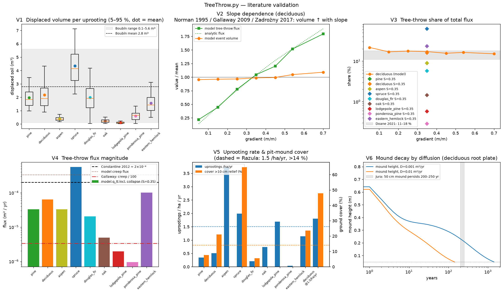
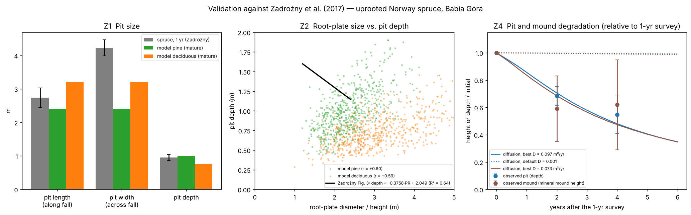

# TreeThrow.py — validation results

Generated by `validation/run_validation.py` in 0.9 min. Figures: `validation_summary.png`; data: `validation_results.json`.

> **Benchmark caveat.** The publishers' websites could not be reached when this suite was built, so every benchmark value below comes from abstracts or search summaries (status *secondary*). Check them against the original papers before relying on the verdicts.

## Scorecard

| Test | Benchmark | Model | Verdict |
|---|---|---|---|
| V0 internal: simulated / analytic D_tt (pine) | 1.0 | 0.94 ± 0.05 (SE) | PASS |
| V0 internal: simulated / analytic D_tt (deciduous) | 1.0 | 0.85 ± 0.13 (SE) | PASS |
| V0 internal: simulated / analytic D_tt (aspen) | 1.0 | 0.99 ± 0.06 (SE) | PASS |
| V1 mean event volume (deciduous) | 2.8 m³ (Boubín) | 3.59 m³ | PASS |
| V1 mean event volume (pine) | 2.8 m³ (Boubín) | 2.47 m³ | PASS |
| V1b deciduous vs. Sudetes beech root plates | 2.4 m³ (Pawlik 2016) | 3.59 m³ (×1.49) | PASS |
| V1b deciduous vs. Carpathian root plates | 2.2–3.35 m³ | 3.59 m³ | PARTIAL |
| V1b pine vs. Sudetes spruce site means (conifer proxy) | 0.4–4.2 m³ (Pawlik 2016) | 2.47 m³ | PASS |
| V1b pine vs. 40 cm DBH spruce (conifer proxy) | 1.0 ± 0.25 m³ | 2.47 m³ (×2.5) | FAIL |
| V2 event volume increases with slope | yes (Norman 1995; Gallaway 2009; Zadrożny 2017) | +3 % per unit gradient | FAIL |
| V2 tree-throw flux increases with slope | yes | +248 % per unit gradient | PASS |
| V3 tree-throw share of flux (deciduous, S = 0.35) | 11–18 % (Doane 2021) | 19 % | PARTIAL |
| V4 flux within 10× of Constantine 2012 (pine) | 2×10⁻⁴ m²/yr | 6.8e-05 m²/yr | PASS |
| V4 flux within 10× of Constantine 2012 (deciduous) | 2×10⁻⁴ m²/yr | 8.0e-05 m²/yr | PASS |
| V4 flux within 10× of Constantine 2012 (aspen) | 2×10⁻⁴ m²/yr | 5.1e-05 m²/yr | PASS |
| V4 tree throw ≈ 1 % of creep (deciduous) | ≤ ~1–3 % (Gallaway 2007/2009) | 24 % | FAIL |
| V5 uprooting rate (deciduous) | 1.5 /ha/yr (Razula) | 0.43 /ha/yr | FAIL |
| V5 pit-mound cover at Razula rate | > 14 % | 72 % (>10 cm relief) | PASS |
| V6 mound persistence, default D = 1×10⁻³ m²/yr | 200–250 yr (Jura) | 240 yr to half height; 1830 yr to < 5 cm | PARTIAL |
| Z1 pit volume, model pine vs. 1-yr spruce pits | 4.3–5.8 m³ (from Table 1) | 2.47 m³ | PARTIAL |
| Z1 pit volume, model deciduous vs. 1-yr spruce pits | 4.3–5.8 m³ (from Table 1) | 3.59 m³ | PARTIAL |
| Z1 pit depth, model pine vs. spruce | 0.95 ± 0.09 m | 1.00 m | PASS |
| Z1 pit diameter, model pine vs. spruce (√(L·W)) | 3.40 m | 2.40 m | FAIL |
| Z2 sign of size–depth correlation | r = -0.80 (Fig. 3) | r = +0.60 (pine) | FAIL |
| Z3 soil dislocation increases with slope | yes (RDA, Fig. 4) | +3 % per unit gradient | FAIL |
| Z4 pit depth after 2 / 4 yr, default D | 0.68 / 0.55 of initial | 0.997 / 0.994 | FAIL |
| Z4 one diffusivity fits both 2- and 4-yr pit data | within 2 SE | best D = 0.097 m²/yr → 0.71 / 0.48 | PASS |

## Details

### V0 — internal consistency

The tree-throw diffusivity produced by the simulation is compared with the diffusivity computed directly from the species parameters (Monte-Carlo expectation for an infinite planar slope). Ratios per seed:

* **pine**: 1.00, 1.17, 0.91, 0.87, 0.95, 0.77
* **deciduous**: 1.14, 1.06, 0.42, 0.49, 0.87, 1.13
* **aspen**: 1.26, 1.04, 0.91, 0.98, 0.91, 0.82

### V1 — event volume

| species | events | mean | median | 5th pct | 95th pct | within 0.1–5.6 m³ |
|---|---|---|---|---|---|---|
| pine | 1768 | 2.47 | 1.94 | 0.63 | 6.09 | 93 % |
| deciduous | 1233 | 3.59 | 2.64 | 0.68 | 10.01 | 84 % |
| aspen | 10502 | 0.50 | 0.39 | 0.12 | 1.24 | 97 % |

### V2 — slope dependence (deciduous)

| gradient | mean event volume (m³) | q_tt sim (m²/yr) | q_tt analytic | D_tt sim (m²/yr) | mean cos(fall) | tree-throw share |
|---|---|---|---|---|---|---|
| 0.05 | 3.51 ± 0.09 | 2.42e-05 | 1.42e-05 | 4.84e-04 | 0.05 | 23 % |
| 0.15 | 3.33 ± 0.08 | 4.57e-05 | 4.23e-05 | 3.05e-04 | 0.15 | 24 % |
| 0.25 | 3.43 ± 0.09 | 6.29e-05 | 6.91e-05 | 2.52e-04 | 0.24 | 20 % |
| 0.35 | 3.45 ± 0.08 | 1.01e-04 | 9.41e-05 | 2.90e-04 | 0.33 | 23 % |
| 0.45 | 3.53 ± 0.09 | 1.31e-04 | 1.17e-04 | 2.90e-04 | 0.41 | 23 % |
| 0.54 | 3.48 ± 0.09 | 1.43e-04 | 1.35e-04 | 2.65e-04 | 0.47 | 22 % |
| 0.70 | 3.49 ± 0.09 | 1.73e-04 | 1.63e-04 | 2.47e-04 | 0.57 | 21 % |

### V4 — flux magnitude

| species | q_tt (m²/yr) | D_tt (m²/yr) | q_tt / creep | q_tt / Constantine | D_tt / Constantine peak D |
|---|---|---|---|---|---|
| pine | 6.79e-05 | 1.94e-04 | 20 % | 0.34 | 0.055 |
| deciduous | 8.02e-05 | 2.29e-04 | 24 % | 0.40 | 0.065 |
| aspen | 5.07e-05 | 1.45e-04 | 15 % | 0.25 | 0.041 |

### V5 — uprooting rate and pit-mound cover

Cover is the fraction of the hillslope whose elevation differs from a 3 m Gaussian-smoothed surface by more than the threshold.

| case | uprootings /ha/yr | cover > 5 cm | > 10 cm | > 20 cm |
|---|---|---|---|---|
| pine | 0.61 | 60 % | 37 % | 17 % |
| deciduous | 0.43 | 68 % | 45 % | 22 % |
| aspen | 3.65 | 45 % | 20 % | 6 % |
| deciduous at 1.5 /ha/yr | 1.52 | 86 % | 72 % | 50 % |

### V6 — mound persistence

A single mature deciduous root plate (R = 1.60 m, H = 0.75 m) is uprooted downslope and then left to diffuse.

| D (m²/yr) | initial mound height (m) | time to half height (yr) | time to < 5 cm (yr) |
|---|---|---|---|
| 0.001 | 0.80 | 240 | 1830 |
| 0.01 | 0.80 | 24 | 184 |

D that reproduces the Jura 200–250 yr persistence: **1.1e-03 m²/yr** if persistence means losing half the mound height, or **8.1e-03 m²/yr** if it means decaying below 5 cm. Martin et al. (2013) inferred 0.01–0.1 m²/yr for pit-mound degradation in the Canadian Rockies.

### Z — Zadrożny et al. (2017), uprooted Norway spruce (primary data)

Source: [Zadrożny P, Halecki W, Gąsiorek M, Nicia P, Lamorski T (2017) iForest 10:783-787, doi:10.3832/ifor1959-010](https://iforest.sisef.org/contents/?id=ifor1959-010); the full text was read. Old-growth *Picea abies*, 110 yr, mean DBH 33 cm, slopes 10–40°, 75 pit-mounds surveyed 1, 3 and 5 yr after a November 2004 windstorm.

**Table 1 (mean ± SE)**

| parameter | 1 yr | 3 yr | 5 yr |
|---|---|---|---|
| pit length m | 2.74 ± 0.29 | 2.26 ± 0.05 | 2.18 ± 0.09 |
| pit width m | 4.23 ± 0.24 | 3.68 ± 0.12 | 3.28 ± 0.28 |
| pit depth m | 0.95 ± 0.09 | 0.65 ± 0.02 | 0.52 ± 0.12 |
| root plate height m | 2.35 ± 0.15 | 1.98 ± 0.34 | 1.82 ± 0.45 |
| mineral mound height m | 0.71 ± 0.22 | 0.42 ± 0.11 | 0.44 ± 0.19 |
| organic mound height m | 0.33 ± 0.09 | 0.32 ± 0.07 | 0.38 ± 0.08 |

**Z1 geometry.** The 1-yr pits are 2.74 m long × 4.23 m wide × 0.95 m deep (width/length = 1.54; equivalent diameter 3.40 m). Pit volume implied by these dimensions is 4.3–5.8 m³ (paraboloid to half-ellipsoid; this conversion is ours, the paper gives no volumes). The model's pits are circular, whereas the observed pits are about 1.5× wider across the fall line than along it.

| model | mature diameter (m) | mature depth (m) | mean event volume (m³) | volume / observed midpoint |
|---|---|---|---|---|
| pine | 2.40 | 1.00 | 2.47 | 0.49 |
| deciduous | 3.20 | 0.75 | 3.59 | 0.71 |

**Z2 size–depth relation.** Zadrożny Fig. 3: pit depth = −0.3758 × root-plate height + 2.049 (R² = 0.64, r = -0.80); taller root plates have shallower pits, which the authors attribute to backward rotation of the uprooting tree. The model draws diameter and depth with a positive correlation (r = +0.60 pine, +0.59 deciduous), so it has the opposite sign.

**Z4 short-term degradation.** A fresh model pit matched to the 1-yr pit (radius 1.70 m, depth 0.95 m, slope 25°) is left to diffuse; the 3- and 5-yr survey means are compared at t = 2 and 4 yr. The survey is a chronosequence (different trees in each age class), and the 3- vs 5-yr differences are mostly not significant (Table 1 letters).

| quantity | observed ratio 2 yr | 4 yr | best-fit D (m²/yr) | model at best D (2 / 4 yr) | model at D = 0.001 |
|---|---|---|---|---|---|
| pit depth | 0.68 ± 0.07 | 0.55 ± 0.14 | 0.097 | 0.71 / 0.48 | 0.997 / 0.994 |
| mineral mound height | 0.59 ± 0.24 | 0.62 ± 0.33 | 0.073 | 0.69 / 0.47 | 0.996 / 0.992 |

Joint fit (pit and mound): D = 0.095 m²/yr, i.e. 95× the model's default hillslope diffusivity of 0.001 m²/yr.

## Benchmarks used

| key | value | source | status |
|---|---|---|---|
| `boubin_pit_mound_volume` | {"mean_m3": 2.8, "min_m3": 0.1, "max_m3": 5.6} | [Šamonil et al., Boubínský old-growth forest (Fagus/Picea), as cited in Geographica Helvetica 76:319 (2021), Jura Mountains tree-throw study](https://gh.copernicus.org/articles/76/319/2021/) | secondary |
| `norman_1995_slope_trend` | {"finding": "pit and mound volumes increase with slope angle; 189 pit-mound pairs, slopes 0-54 %, northern Lower Michigan, sandy soils"} | [Norman, Schaetzl & Small (1995) Geomorphology 14:19-27](https://people.geo.msu.edu/schaetzl/PDFs/Norman-treethrow.pdf) | secondary |
| `gallaway_2009_slope_trend` | {"finding": "significant relation between gradient and root-plate volume; sediment disturbance higher on steeper gradients", "flux_vs_creep": "root-throw transport ~two orders of magnitude below creep (2007 AGU abstract)"} | [Gallaway, Martin & Johnson (2009) ESPL 34:1255-1269; 2007 AGU abstract H53C-1401](https://ui.adsabs.harvard.edu/abs/2007AGUFM.H53C1401G/abstract) | secondary |
| `zadrozny_2017_spruce` | {"pit_1yr_LxWxD_m": [2.74, 4.23, 0.95], "pit_depth_vs_root_plate_height": "depth = -0.3758*PR + 2.049, R2 = 0.64", "finding": "slope steepness has the largest influence on soil dislocation (RDA)"} | [Zadrożny et al. (2017) iForest 10:783-787, doi:10.3832/ifor1959-010 (see validation/zadrozny.py for Table 1)](https://iforest.sisef.org/contents/?id=ifor1959-010) | primary (full text read) |
| `pawlik_2016_sudetes_root_plate` | {"spruce_site_mean_min_m3": 0.4, "spruce_site_mean_max_m3": 4.2, "beech_mean_m3": 2.4} | [Pawlik et al. (2016) ESPL, Sudetes Mountains, doi:10.1002/esp.3950](https://onlinelibrary.wiley.com/doi/10.1002/esp.3950) | secondary |
| `carpathian_root_plate` | {"mean_min_m3": 2.2, "mean_max_m3": 3.35} | [Uprooting study, Polish Carpathians (as summarised in search results; citation to confirm)](https://www.researchgate.net/publication/309006609_Domination_of_hillslope_denudation_by_tree_uprooting_in_an_old-growth_forest) | secondary (citation unconfirmed) |
| `spruce_40cm_dbh_volume` | {"dbh_cm": 40, "volume_m3": 1.0, "sd_m3": 0.25} | [Review estimate for a ~100-150-yr-old Norway spruce (as summarised in search results; citation to confirm)](https://doi.org/10.3390/f11111143) | secondary (citation unconfirmed) |
| `doane_2021_flux_share` | {"share_min": 0.11, "share_max": 0.18, "aspect_effect": "~50 % higher tree-throw flux on east-facing slopes"} | [Doane et al. (2021) GRL, doi:10.1029/2021GL094987 (southern Indiana hardwoods)](https://agupubs.onlinelibrary.wiley.com/doi/full/10.1029/2021GL094987) | secondary |
| `constantine_2012_flux` | {"flux_m2_yr": 0.0002, "peak_D_m2_yr": 0.0035} | [Constantine, Schelhaas, Gabet & Mudd (2012) Geomorphology (windthrow model)](https://www.sciencedirect.com/science/article/abs/pii/S0169555X12003066) | secondary |
| `razula_2017_rate_coverage` | {"uprootings_per_ha_yr": 1.5, "pit_mound_cover_min": 0.14} | [Razula old-growth forest, Western Carpathians (Fagus/Abies/Picea), Geomorphology 2017 (Šamonil group)](https://is.muni.cz/publication/1402037) | secondary |
| `jura_2021_mound_persistence` | {"mound_height_m": 0.5, "persistence_yr_min": 200, "persistence_yr_max": 250} | [Geographica Helvetica 76:319 (2021), Jura Mountains tree-throw study](https://gh.copernicus.org/articles/76/319/2021/) | secondary |
| `martin_2013_pitmound_D` | {"D_min_m2_yr": 0.01, "D_max_m2_yr": 0.1} | [Martin et al. (2013) Geomorphology, Canadian Rockies pit-mound degradation modelling](https://www.sciencedirect.com/science/article/abs/pii/S0169555X13002237) | secondary |
