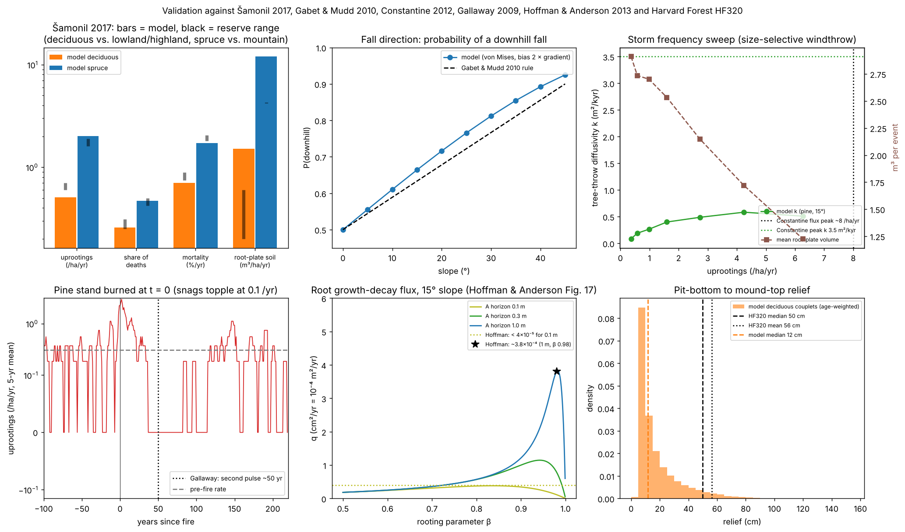

# TreeThrow.py — validation results

Generated by `validation/run_validation.py` in 2.5 min. Figures: `validation_summary.png`; data: `validation_results.json`.

> **Benchmark caveat.** Zadrożny et al. (2017) (Z rows), Doane et al. (2021) (D rows, V3), Šamonil et al. (2017) (S), Gabet & Mudd (2010) (G), Constantine et al. (2012) (C), Hoffman & Anderson (2013) (H) and the Harvard Forest HF320-03 data summary (HF) were read in full; Gallaway et al. (2009) (L) from its abstract, introduction and study area. Every other benchmark comes from abstracts or search summaries (status *secondary*) because the publishers' websites could not be reached; check them against the original papers before relying on those verdicts.

## Scorecard

| Test | Benchmark | Model | Verdict |
|---|---|---|---|
| V0 internal: simulated / analytic D_tt (pine) | 1.0 | 1.03 ± 0.05 (SE) | PASS |
| V0 internal: simulated / analytic D_tt (deciduous) | 1.0 | 0.93 ± 0.08 (SE) | PASS |
| V0 internal: simulated / analytic D_tt (aspen) | 1.0 | 0.95 ± 0.01 (SE) | PASS |
| V0 internal: simulated / analytic D_tt (spruce) | 1.0 | 1.03 ± 0.02 (SE) | PASS |
| V1 mean displaced volume (deciduous) | 2.8 m³ (Boubín) | 2.17 m³ | PASS |
| V1 mean displaced volume (pine) | 2.8 m³ (Boubín) | 1.99 m³ | PASS |
| V1 mean displaced volume (spruce) | 2.8 m³ (Boubín) | 4.37 m³ | FAIL |
| V1b deciduous vs. Sudetes beech root plates | 2.4 m³ (Pawlik 2016) | 2.17 m³ (×0.90) | PASS |
| V1b deciduous vs. Carpathian root plates | 2.2–3.35 m³ | 2.17 m³ | PARTIAL |
| V1b pine vs. Sudetes spruce site means (conifer proxy) | 0.4–4.2 m³ (Pawlik 2016) | 1.99 m³ | PASS |
| V1b pine vs. 40 cm DBH spruce (unconfirmed review value) | 1.0 ± 0.25 m³ | 1.99 m³ (×2.0) | N/A — contradicted by primary spruce data (Z1) |
| V2 event volume increases with slope | yes (Norman 1995; Gallaway 2009; Zadrożny 2017) | +21 % per unit gradient | PASS |
| V2 tree-throw flux increases with slope | yes | +248 % per unit gradient | PASS |
| V3 tree-throw share of flux (deciduous, S = 0.35) | 11–18 % (Doane 2021, primary) | 16 % | PASS |
| V4 flux within 10× of Constantine 2012 (pine) | 2×10⁻⁴ m²/yr | 3.3e-05 m²/yr | PASS |
| V4 flux within 10× of Constantine 2012 (deciduous) | 2×10⁻⁴ m²/yr | 6.4e-05 m²/yr | PASS |
| V4 flux within 10× of Constantine 2012 (aspen) | 2×10⁻⁴ m²/yr | 3.1e-05 m²/yr | PASS |
| V4 flux within 10× of Constantine 2012 (spruce) | 2×10⁻⁴ m²/yr | 5.5e-04 m²/yr | PASS |
| V4 tree throw ≈ 1 % of creep (deciduous) | ≤ ~1–3 % (Gallaway 2007/2009) | 19 % | FAIL |
| V5 uprooting rate (deciduous) | 1.5 /ha/yr (Razula, mountain old growth, secondary) | 0.51 /ha/yr | FAIL (lowland/highland reserves: see S1) |
| V5 uprooting rate (spruce) | 1.5 /ha/yr (Razula, mixed beech–fir–spruce) | 2.01 /ha/yr | PASS |
| V5 pit-mound cover at Razula rate | > 14 % | 49 % (>10 cm relief) | PASS |
| V6 persistence of a 50 cm mound (to < 5 cm), default D | 200–250 yr (Jura, secondary) | 1417 yr (fresh mound halves in 7 yr) | FAIL (Michigan mounds last 2420 yr: see G4) |
| Z1 spruce pit depth at 1 yr (calibrated) | 0.95 ± 0.09 m | 0.94 m | PASS |
| Z1 spruce pit volume at 1 yr (calibrated) | 4.3–5.8 m³ | 4.99 m³ | PASS |
| Z1 spruce pit length / width at 1 yr | 2.74 / 4.23 m | 2.75 / 5.00 m | PARTIAL |
| Z2 sign of size–depth correlation (spruce) | r = -0.80 (Fig. 3) | r = -0.77 | PASS |
| Z2 sign of size–depth correlation (pine) | r = -0.80 (Fig. 3) | r = -0.56 | PASS |
| Z2 sign of size–depth correlation (deciduous) | r = -0.80 (Fig. 3) | r = -0.56 | PASS |
| Z3 soil dislocation increases with slope | yes (RDA, Fig. 4) | +21 % per unit gradient | PASS |
| Z4 spruce pit depth at 3 / 5 yr | 0.65 / 0.52 m | 0.63 / 0.53 m | PASS |
| Z4 spruce mound height at 1 / 3 / 5 yr | mineral 0.71 / 0.42 / 0.44 m; +organic 1.04 / 0.74 / 0.82 m | 1.05 / 0.68 / 0.56 m | PARTIAL |
| D1 tree-throw share of flux (deciduous, S = 0.35) | 11–18 % (Doane 2021, primary) | 16 % | PASS |
| D2 topographic variance, deciduous, S = 0.15–0.54 | 0.001–0.03 m² | 0.0084–0.0121 m² | PASS |
| D2 variance increases with slope | yes (Fig. 4b) | +75 % per unit gradient | PASS |
| D3 Doane Eq. 9 on model DEM vs. model's true R (S = 0.25–0.54) | ratio 1 | 1.80 | PASS |
| D4 couplet mound volume at 7 yr (deciduous) | ≈ 2.0 m³ (derived) | 1.59 m³ | PASS |
| D4 couplet mound height at 7 yr (deciduous) | ≈ 0.43 m (derived) | 0.39 m | PASS |
| D4 couplet length / width φ | 0.83 (Doane); 0.65 (Zadrożny pits) | 0.67 | PASS |
| S1 uprooting rate, deciduous | 0.6–0.7 /ha/yr (Šamonil lowland/highland) | 0.51 /ha/yr | PASS |
| S2 uprooting share of deaths, deciduous | 25–31 % | 26 % | PASS |
| S3 annual mortality per stem, deciduous | 0.7–0.9 % | 0.7 % | PASS |
| S4 root-plate volume per uprooting, deciduous | 0.3–1.0 m³ | 3.0 m³ | FAIL |
| S5 pit-mound area created, deciduous | 1.5–2.7 m²/ha/yr | 6.9 m²/ha/yr | FAIL |
| S6 root-plate soil volume, deciduous | 0.2–0.6 m³/ha/yr | 1.5 m³/ha/yr | FAIL |
| S1 uprooting rate, spruce | 1.6–1.9 /ha/yr (Šamonil mountain) | 2.01 /ha/yr | PASS |
| S2 uprooting share of deaths, spruce | 42–50 % | 47 % | PASS |
| S3 annual mortality per stem, spruce | 1.8–2.0 % | 1.7 % | PASS |
| S4 root-plate volume per uprooting, spruce | 2.3–2.6 m³ | 6.0 m³ | FAIL |
| S5 pit-mound area created, spruce | 9.6–10.3 m²/ha/yr | 30.2 m²/ha/yr | FAIL |
| S6 root-plate soil volume, spruce | 4.2–4.3 m³/ha/yr | 12.0 m³/ha/yr | FAIL |
| G1 fall direction vs. Gabet & Mudd rule (0–45°) | 50 % → 90 % downhill | max difference 5 % | PASS |
| G2 pine topple share of deaths (calibrated) | 15 % (Douglas fir) | 16 % | PASS |
| G3 pine pit volume | 3.0 ± 1.3 m³ (Douglas fir) | 2.7 m³ | PASS |
| G4 mound lifetime (to < 5 cm, D = 0.001) | oldest recognisable mound 2420 yr (Michigan) | 1420 yr | PASS |
| C1 transport per event, pine: k / (rate × V) | 1.52 m (Constantine/Gabet 2003, S = 0.35) | 1.18 m | PASS |
| C1 transport per event, deciduous: k / (rate × V) | 1.52 m (Constantine/Gabet 2003, S = 0.35) | 1.24 m | PASS |
| C1 transport per event, spruce: k / (rate × V) | 1.52 m (Constantine/Gabet 2003, S = 0.35) | 1.46 m | PASS |
| C2 storms deplete large trees: volume per event falls at high windthrow rates | yes | 2.9 → 1.2 m³ | PASS |
| C3 tree-throw flux peaks, then declines, as windthrow rate rises | peak near 8 /ha/yr, k ≈ 3.5 m²/kyr | peak at 4.2 /ha/yr, k = 0.6 m²/kyr | PASS |
| L1 pine flux on steep slopes, no fire | 1.6e-06 m²/yr (Gallaway, steepest plots) | 4.2e-05 m²/yr (×26) | FAIL |
| L2 post-fire / pre-fire flux (first 5 yr) | 11× | 4× | PARTIAL |
| L3 second uprooting pulse after fire | ~50 yr | 116 yr | FAIL |
| H1 root-cycle flux formula reproduces Hoffman & Anderson | 4 published values | 3.80×10⁻⁴ at β 0.98 … | PASS |
| HF1 pit-to-mound relief, median, couplets < 150 yr old | 50 cm (Harvard Forest, n = 629) | 51 cm | PASS |
| HF2 pit-to-mound relief, median, all couplets > 5 cm (steady state) | 50 cm | 12 cm | FAIL |

## Change from previous model versions

*original model*: before the root-plate, infill and pit-mound-collapse changes; *paraboloid pits*: with those changes but paraboloid pits (D_f = 0.15 m²/yr); *updated*: flat-floored pits (n = 4), D_f = 0.20 m²/yr. Pit depth after 3 / 5 yr is shown relative to the 1-yr pit.

| metric | literature | original model | paraboloid pits | updated |
|---|---|---|---|---|
| V1 mean displaced volume, deciduous (m³) | ≈ 2.4–2.8 | 3.59 | 2.50 | 2.17 |
| V1 mean displaced volume, pine (m³) | ≈ 2.8 | 2.47 | 1.56 | 1.99 |
| V2 displaced volume trend with slope (% per unit gradient) | > 0 | 3 % | 22 % | 21 % |
| V3 tree-throw share of flux, deciduous | 11–18 % | 19 % | 17 % | 16 % |
| V4 tree-throw flux, deciduous (m²/yr) | 2×10⁻⁴ | 8.0e-05 | 7.0e-05 | 6.4e-05 |
| V5 uprooting rate, deciduous (/ha/yr) | 1.5 | 0.43 | 0.48 | 0.51 |
| V5 pit-mound cover > 10 cm, deciduous | > 14 % | 45 % | 20 % | 21 % |
| V5 pit-mound cover > 10 cm at Razula rate | > 14 % | 72 % | 39 % | 49 % |
| V6 fresh mound half-height time (yr) | ≈ 2–3 (Zadrożny mound 0.71→0.42 m in 2 yr) | 240 | 4 | 7 |
| Z2 size–depth correlation, pine | −0.80 | +0.60 | -0.56 | -0.56 |
| Spruce fresh open-pit depth (m) | ≥ 0.95 (1-yr depth) | — | 1.15 | 1.16 |
| Spruce pit depth at 1 yr (m) | 0.95 ± 0.09 | — | 0.91 | 0.94 |
| Topographic variance, deciduous, S = 0.35 (m²) | 0.001–0.03 | — | 0.0074 | 0.0088 |
| Couplet mound height at 7 yr, deciduous (m) | ≈ 0.43 (derived) | — | 0.25 | 0.39 |
| V6 persistence of a 50 cm mound to < 5 cm (yr) | 200–250 | 1670 | 1499 | 1417 |
| Z4 spruce pit depth at 3 / 5 yr, relative to 1 yr | 0.68 / 0.55 | 1.00 / 0.99 | 0.72 / 0.62 | 0.67 / 0.57 |

## Details

### V0 — internal consistency

The tree-throw diffusivity produced by the simulation is compared with the diffusivity computed directly from the species parameters (Monte-Carlo expectation for an infinite planar slope). Ratios per seed:

* **pine**: 0.95, 1.19, 1.00, 1.10, 0.83, 1.10
* **deciduous**: 1.01, 1.03, 1.23, 0.83, 0.69, 0.76
* **aspen**: 1.00, 0.94, 0.94, 0.94, 0.97, 0.92
* **spruce**: 1.01, 0.96, 1.04, 1.01, 1.02, 1.11

### V1 — event volume

| species | events | mean | median | 5th pct | 95th pct | within 0.1–5.6 m³ |
|---|---|---|---|---|---|---|
| pine | 992 | 1.99 | 1.83 | 0.97 | 3.50 | 100 % |
| deciduous | 1462 | 2.17 | 1.89 | 0.89 | 4.37 | 98 % |
| aspen | 10713 | 0.40 | 0.36 | 0.18 | 0.72 | 100 % |
| spruce | 5788 | 4.37 | 4.18 | 2.23 | 7.13 | 81 % |

### V2 — slope dependence (deciduous)

| gradient | mean event volume (m³) | q_tt sim (m²/yr) | q_tt analytic | D_tt sim (m²/yr) | mean cos(fall) | tree-throw share |
|---|---|---|---|---|---|---|
| 0.05 | 2.09 ± 0.03 | 1.49e-05 | 9.57e-06 | 2.99e-04 | 0.05 | 22 % |
| 0.15 | 2.11 ± 0.03 | 3.02e-05 | 3.10e-05 | 2.01e-04 | 0.15 | 17 % |
| 0.25 | 2.12 ± 0.03 | 5.27e-05 | 5.15e-05 | 2.11e-04 | 0.24 | 18 % |
| 0.35 | 2.16 ± 0.03 | 7.03e-05 | 7.08e-05 | 2.01e-04 | 0.33 | 17 % |
| 0.45 | 2.18 ± 0.03 | 8.11e-05 | 8.87e-05 | 1.80e-04 | 0.41 | 15 % |
| 0.54 | 2.29 ± 0.03 | 1.03e-04 | 1.03e-04 | 1.91e-04 | 0.47 | 16 % |
| 0.70 | 2.39 ± 0.03 | 1.22e-04 | 1.28e-04 | 1.74e-04 | 0.57 | 15 % |

### V4 — flux magnitude

| species | q_tt (m²/yr) | D_tt (m²/yr) | q_tt / creep | q_tt / Constantine | D_tt / Constantine peak D |
|---|---|---|---|---|---|
| pine | 3.33e-05 | 9.52e-05 | 10 % | 0.17 | 0.027 |
| deciduous | 6.42e-05 | 1.83e-04 | 19 % | 0.32 | 0.052 |
| aspen | 3.13e-05 | 8.94e-05 | 9 % | 0.16 | 0.026 |
| spruce | 5.51e-04 | 1.57e-03 | 164 % | 2.76 | 0.450 |

### V5 — uprooting rate and pit-mound cover

Cover is the fraction of the hillslope whose elevation differs from a 3 m Gaussian-smoothed surface by more than the threshold.

| case | uprootings /ha/yr | cover > 5 cm | > 10 cm | > 20 cm |
|---|---|---|---|---|
| pine | 0.34 | 26 % | 8 % | 1 % |
| deciduous | 0.51 | 49 % | 21 % | 4 % |
| aspen | 3.72 | 6 % | 0 % | 0 % |
| spruce | 2.01 | 81 % | 62 % | 33 % |
| deciduous at 1.5 /ha/yr | 1.81 | 73 % | 49 % | 17 % |

### V6 — mound persistence

A single mature deciduous root plate (R = 1.43 m, H = 0.75 m) is uprooted downslope and then left to diffuse.

| D (m²/yr) | initial mound height (m) | time to half height (yr) | time to 50 cm (yr) | time to < 5 cm (yr) |
|---|---|---|---|---|
| 0.001 | 0.80 | 7 | 3 | 1420 |
| 0.01 | 0.80 | 4 | 3 | 144 |

The fresh mound first collapses quickly (fresh-soil diffusivity), then decays by background diffusion. Time for the mound to go from 50 cm to below 5 cm at D = 0.001 m²/yr: **1417 yr** (Jura benchmark 200–250 yr). Background D that would reproduce the benchmark: **6.30e-03 m²/yr**. Martin et al. (2013) inferred 0.01–0.1 m²/yr for pit-mound degradation in the Canadian Rockies.

### Z — Zadrożny et al. (2017), uprooted Norway spruce (primary data)

Source: [Zadrożny P, Halecki W, Gąsiorek M, Nicia P, Lamorski T (2017) iForest 10:783-787, doi:10.3832/ifor1959-010](https://iforest.sisef.org/contents/?id=ifor1959-010); the full text was read. Old-growth *Picea abies*, 110 yr, mean DBH 33 cm, slopes 10–40°, 75 pit-mounds surveyed 1, 3 and 5 yr after a November 2004 windstorm. The model's spruce preset and its fresh pit-mound collapse parameters were calibrated to these data, so the spruce rows of Z1 and Z4 are calibration checks; the pine and deciduous rows and Z2–Z3 are independent.

**Table 1 (mean ± SE)**

| parameter | 1 yr | 3 yr | 5 yr |
|---|---|---|---|
| pit length m | 2.74 ± 0.29 | 2.26 ± 0.05 | 2.18 ± 0.09 |
| pit width m | 4.23 ± 0.24 | 3.68 ± 0.12 | 3.28 ± 0.28 |
| pit depth m | 0.95 ± 0.09 | 0.65 ± 0.02 | 0.52 ± 0.12 |
| root plate height m | 2.35 ± 0.15 | 1.98 ± 0.34 | 1.82 ± 0.45 |
| mineral mound height m | 0.71 ± 0.22 | 0.42 ± 0.11 | 0.44 ± 0.19 |
| organic mound height m | 0.33 ± 0.09 | 0.32 ± 0.07 | 0.38 ± 0.08 |

**Z1 — pit one year after uprooting** (single mature tree falling downslope on a 25° slope). Pit length and width are the extent of ground at least 10 cm below the pre-uproot surface; values for a 5 cm edge are given in brackets. Observed pit volume implied by Table 1: 4.3–5.8 m³ (our paraboloid-to-half-ellipsoid conversion).

| model | fresh open pit depth (m) | depth 1 yr (m) | length 1 yr (m) | width 1 yr (m) | width/length | pit volume 1 yr (m³) |
|---|---|---|---|---|---|---|
| observed spruce | — | 0.95 | 2.74 | 4.23 | 1.54 | 4.3–5.8 |
| spruce | 1.16 | 0.94 | 2.75 (3.00) | 5.00 (5.50) | 1.82 | 4.99 |
| pine | 0.83 | 0.50 | 2.00 (2.25) | 3.50 (4.00) | 1.75 | 1.66 |
| deciduous | 0.62 | 0.57 | 2.00 (2.25) | 3.50 (4.00) | 1.75 | 2.01 |

**Z2 — size–depth relation.** Zadrożny Fig. 3: pit depth = −0.3758 × root-plate height + 2.049 (R² = 0.64, r = -0.80). Model correlation of plate diameter and depth at death: spruce -0.77, pine -0.56, deciduous -0.56.

**Z4 — degradation.** Model spruce pit and mound (fresh collapse D = 0.2 m²/yr decaying with e-folding time 3.0 yr, plus background D = 0.001 m²/yr) against the survey. The survey is a chronosequence (different trees in each age class). The model mound contains all root-plate soil, so it is compared with both the mineral mound and mineral + organic mound.

| quantity | age (yr) | observed | model | (model − obs) / SE |
|---|---|---|---|---|
| pit depth | 1 | 0.95 ± 0.09 | 0.94 | -0.1 |
| pit depth | 3 | 0.65 ± 0.02 | 0.63 | -0.8 |
| pit depth | 5 | 0.52 ± 0.12 | 0.53 | +0.1 |
| pit length | 1 | 2.74 ± 0.29 | 2.75 | +0.0 |
| pit length | 3 | 2.26 ± 0.05 | 2.75 | +9.8 |
| pit length | 5 | 2.18 ± 0.09 | 2.75 | +6.3 |
| pit width | 1 | 4.23 ± 0.24 | 5.00 | +3.2 |
| pit width | 3 | 3.68 ± 0.12 | 5.50 | +15.2 |
| pit width | 5 | 3.28 ± 0.28 | 5.50 | +7.9 |
| mineral mound height | 1 | 0.71 ± 0.22 | 1.05 | +1.6 |
| mineral mound height | 3 | 0.42 ± 0.11 | 0.68 | +2.3 |
| mineral mound height | 5 | 0.44 ± 0.19 | 0.56 | +0.6 |
| mineral + organic mound height | 1 | 1.04 ± 0.24 | 1.05 | +0.1 |
| mineral + organic mound height | 3 | 0.74 ± 0.13 | 0.68 | -0.5 |
| mineral + organic mound height | 5 | 0.82 ± 0.21 | 0.56 | -1.3 |

Pit size through time: observed length 2.74 → 2.18 m and width 4.23 → 3.28 m from 1 to 5 yr (pits narrow); model 2.75 → 2.75 m and 5.00 → 5.50 m. Diffusive collapse lowers the rim and widens the depression, whereas the surveyed pits narrow (rim slumping and litter infill at the edges, or partly the chronosequence: the 1-yr cohort also has taller root plates). This is a structural limitation of the diffusive collapse.

Pit depth at 5 yr / 1 yr: observed 0.55, model 0.57, model without fresh collapse 1.00.

### D — Doane et al. (2021), forested hillslopes of southern Indiana (primary data)

Source: [Doane TH, Edmonds D, Yanites BJ, Lewis Q (2021) Geophys. Res. Lett. 48, e2021GL094987, doi:10.1029/2021GL094987](https://agupubs.onlinelibrary.wiley.com/doi/full/10.1029/2021GL094987); the full text was read. Tree throw accounts for 11 % (west-facing, R = 0.12) to 18 % (east-facing, R = 0.22) of hillslope sediment flux; topographic variance of 1,910 hillslopes spans 0.001–0.03 m² and increases with slope.

**D2/D3 — roughness.** Each simulated hillslope (3000 yr, 40 × 40 m) is block-averaged to 0.75 m and high-pass filtered with a 3.8 m Gaussian (our reading of the paper's "length scale of 3.8 m"), as for the lidar DEM. Doane's Eq. 9 is then applied with their fitted couplet parameters (μ_A = 0.68, σ²_A = 0.05, φ = 0.83) to estimate R from roughness, and compared with the model's true R.

Eq. 9 assumes every tree falls straight downslope, so its R grows as 1/S on gentle slopes; the model's fall direction is only weakly biased downslope there (mean cosine of fall azimuth 0.05 at S = 0.05, 0.33 at S = 0.35), so the two diverge below S ≈ 0.2.

| gradient | variance mean (m²) | range over seeds (m²) | model R = q_TT/q_c | R from Eq. 9 |
|---|---|---|---|---|
| 0.05 | 0.0092 | 0.0074–0.0109 | 0.30 | 2.54 |
| 0.15 | 0.0086 | 0.0063–0.0116 | 0.20 | 0.79 |
| 0.25 | 0.0084 | 0.0059–0.0103 | 0.22 | 0.46 |
| 0.35 | 0.0106 | 0.0074–0.0134 | 0.20 | 0.41 |
| 0.45 | 0.0086 | 0.0062–0.0100 | 0.18 | 0.26 |
| 0.54 | 0.0121 | 0.0086–0.0148 | 0.19 | 0.31 |
| 0.70 | 0.0114 | 0.0070–0.0174 | 0.18 | 0.22 |

| species (S = 0.35) | variance (m²) | model R | R from Eq. 9 |
|---|---|---|---|
| pine | 0.0034 | 0.10 | 0.13 |
| deciduous | 0.0088 | 0.19 | 0.34 |
| aspen | 0.0005 | 0.09 | 0.02 |
| spruce | 0.0436 | 1.64 | 1.71 |

**D4 — couplet geometry.** Doane's mean fresh couplet (A = 0.68 m², l = 1 + S, w = l/φ) has a mound volume of 1.96 m³ and peak height 0.43 m at S = 0.35 (our conversion of their Eq. 2). Model deciduous mound after 5 yr: 1.63 m³ / 0.41 m, 7 yr: 1.59 m³ / 0.39 m, 10 yr: 1.56 m³ / 0.37 m. Couplet length/width: model 0.67, Doane 0.83, Zadrożny pits 0.65.

### S — Šamonil et al. (2017), four Czech old-growth reserves (primary data)

Source: Šamonil P, Daněk P, Adam D, Phillips JD (2017) Geomorphology 299:76-84, doi:10.1016/j.geomorph.2017.09.023. Table 2 rates per site; mortality per stem is deaths/ha/yr divided by living stems ≥ 10 cm DBH (Table 1). The model's deciduous stand is compared with the lowland (oak-ash) and highland (beech) reserves, spruce with the two mountain reserves. Pit-mound area per event in the model is the pit plus mound ellipse (≈ 2πR²).

| site | slope (°) | stems/ha | uprooted /ha/yr | broken /ha/yr | share | area m²/ha/yr | volume m³/ha/yr |
|---|---|---|---|---|---|---|---|
| Ranspurk (lowland floodplain, oak-ash) | 1.7 | 281 | 0.7 | 1.6 | 31 % | 1.5 | 0.2 |
| Zakova Hora (highland, beech) | 8.9 | 310 | 0.6 | 1.5 | 25 % | 2.7 | 0.6 |
| Zofin (mountain, beech-spruce-fir) | 8.6 | 205 | 1.6 | 1.9 | 42 % | 9.6 | 4.2 |
| Boubin (mountain, spruce-beech) | 14.4 | 210 | 1.9 | 1.9 | 50 % | 10.3 | 4.3 |

The model's spruce root plates follow Zadrożny's measured pits (≈5–6 m³ excavated), about twice Šamonil's 2.3–2.6 m³ per uprooting in the mountain reserves, whose volumes come from DBH regressions over all trees ≥ 10 cm. The two primary sources disagree on spruce root-plate size.

### G — Gabet & Mudd (2010)

Source: Gabet EJ, Mudd SM (2010) J. Geophys. Res. 115, F04005, doi:10.1029/2009JF001526. Douglas-fir model parameters: annual mortality 1/330; topples 15 % of deaths, only trees > 80 yr; pit volume 3 ± 1.3 m³ (half-ellipsoid, depth ≈ radius/2); P(downhill) 50 → 90 % from 0 to 45°; soil creep D = 2.5×10⁻³ m²/yr; oldest recognisable Michigan mound 2420 yr (Schaetzl & Follmer 1990). The model adopts the pine mortality, topple share and minimum topple age, and the thin-soil root-plate thinning (depth falls to half on bare rock).

Root-plate depth / radius in the model: pine 0.83, deciduous 0.53, aspen 0.67, spruce 0.85 (Gabet & Mudd and Constantine: ≈ 0.5 for Douglas fir).

### C — Constantine et al. (2012)

Source: Constantine JA, Schelhaas M-J, Gabet E, Mudd SM (2012) Geomorphology 175-176:66-73, doi:10.1016/j.geomorph.2012.06.022. Douglas-fir root plates: V = 5.96 ln(d) − 17.1 (5.0 m³ at the 41 cm mean DBH of windthrown trees), half-ellipsoid with p = r/2; transport distance (2/π)(r + p) sin θ for random fall directions (Gabet et al. 2003). Their k at the present windthrow rate (1.4 /ha/yr) is ≈ 1.1e-03 m²/yr by these formulas at S = 0.35. The model has no slope-geometry term; its net transport comes from the downslope fall bias and slope-dependent infill, which together give a similar transport per event (C1).

| storm severity (annual) | uprootings /ha/yr | k (m²/yr) | mean root-plate volume (m³) |
|---|---|---|---|
| 0.0 | 0.37 | 8.50e-05 | 2.91 |
| 0.002 | 0.58 | 1.89e-04 | 2.74 |
| 0.005 | 0.98 | 2.64e-04 | 2.70 |
| 0.01 | 1.60 | 3.99e-04 | 2.53 |
| 0.02 | 2.73 | 4.87e-04 | 2.15 |
| 0.04 | 4.24 | 5.83e-04 | 1.72 |
| 0.08 | 6.26 | 5.09e-04 | 1.23 |

### L — Gallaway et al. (2009), Canadian Rockies (abstract and introduction only)

Source: Gallaway JM, Martin YE, Johnson EA (2009) ESPL 34:1255-1269, doi:10.1002/esp.1813. Root-throw transport on the steepest plots: 0.016 cm³/cm/yr before the 2003 fire and 0.18 cm³/cm/yr after it; fire-killed trees topple at an exponential rate, and a second pulse of root throw begins ~50 yr after fire. The model's pine preset is compared at S = 0.5; the fire scenario kills the whole stand once and lets snags fall at 0.1 /yr with root plates decaying over 15 yr. The second pulse in the model is set by the 80-yr minimum topple age (Gabet & Mudd), later than Gallaway's ~50 yr.

### H — Hoffman & Anderson (2013), Boulder Creek CZO

Source: Hoffman BSS, Anderson RS (2013) Earth Surf. Process. Landforms, doi:10.1002/esp.3470. Root-cycle flux (Gale & Grigal profile, A-horizon roots only), 15° slope, root mass 4.4 kg/m², turnover 0.45 /yr, root density 400 kg/m³: max over β for a 0.1 m A horizon 3.82e-05 (published < 4×10⁻⁵); 1 m A horizon, β 0.98 3.80e-04 (≈ 3.8×10⁻⁴); β 0.8 5.74e-05 (< 6×10⁻⁵); full profile / median-depth formula 1.44 (≈ 40 % larger). Root-cycle diffusivity at β 0.95: A horizon 0.1 m 9.1e-05, A horizon 0.2 m 2.6e-04, A horizon 0.5 m 7.0e-04, A horizon None m 9.7e-04 m²/yr. Model deciduous tree-throw diffusivity 1.8e-04 m²/yr is 0.19× the all-roots root-cycle value (Gabet et al. 2003, via Hoffman: tree throw ≈ 4× root cycling). Root cycling is an optional model process (`root_cycle`), off by default because the default background diffusivity already lumps it with other creep.

### HF — Harvard Forest HF320-03

Source: Harvard Forest Data Archive HF320-03, hf320-03-microtopo.csv (2016). Pit-bottom to mound-top relief of 629 pit-mounds: median 50 cm, mean 56 cm, max 238 cm. Model: 16 deciduous uprootings (sizes drawn from the death distribution) on a 0.2 gradient, followed until relief < 5 cm; a steady population is age-uniform, so each couplet is weighted by time. Model median 12 cm, mean 18 cm, max 273 cm; couplet lifetimes 900–4000 yr. Couplets younger than 150 yr have a median relief of 51 cm. In a steady population of every age, old couplets that linger for centuries at 5–20 cm dominate, so the observed 50 cm median implies that the survey records mainly distinct (younger) pit-mounds, that the stand's couplets are mostly young, or that long-term creep is faster than 0.001 m²/yr.

## Benchmarks used

| key | value | source | status |
|---|---|---|---|
| `boubin_pit_mound_volume` | {"mean_m3": 2.8, "min_m3": 0.1, "max_m3": 5.6} | [Šamonil et al., Boubínský old-growth forest (Fagus/Picea), as cited in Geographica Helvetica 76:319 (2021), Jura Mountains tree-throw study](https://gh.copernicus.org/articles/76/319/2021/) | secondary |
| `norman_1995_slope_trend` | {"finding": "pit and mound volumes increase with slope angle; 189 pit-mound pairs, slopes 0-54 %, northern Lower Michigan, sandy soils"} | [Norman, Schaetzl & Small (1995) Geomorphology 14:19-27](https://people.geo.msu.edu/schaetzl/PDFs/Norman-treethrow.pdf) | secondary |
| `gallaway_2009_slope_trend` | {"finding": "significant relation between gradient and root-plate volume; sediment disturbance higher on steeper gradients", "flux_vs_creep": "root-throw transport ~two orders of magnitude below creep (2007 AGU abstract)"} | [Gallaway, Martin & Johnson (2009) ESPL 34:1255-1269; 2007 AGU abstract H53C-1401](https://ui.adsabs.harvard.edu/abs/2007AGUFM.H53C1401G/abstract) | secondary |
| `zadrozny_2017_spruce` | {"pit_1yr_LxWxD_m": [2.74, 4.23, 0.95], "pit_depth_vs_root_plate_height": "depth = -0.3758*PR + 2.049, R2 = 0.64", "finding": "slope steepness has the largest influence on soil dislocation (RDA)"} | [Zadrożny et al. (2017) iForest 10:783-787, doi:10.3832/ifor1959-010 (see validation/zadrozny.py for Table 1)](https://iforest.sisef.org/contents/?id=ifor1959-010) | primary (full text read) |
| `pawlik_2016_sudetes_root_plate` | {"spruce_site_mean_min_m3": 0.4, "spruce_site_mean_max_m3": 4.2, "beech_mean_m3": 2.4} | [Pawlik et al. (2016) ESPL, Sudetes Mountains, doi:10.1002/esp.3950](https://onlinelibrary.wiley.com/doi/10.1002/esp.3950) | secondary |
| `carpathian_root_plate` | {"mean_min_m3": 2.2, "mean_max_m3": 3.35} | [Uprooting study, Polish Carpathians (as summarised in search results; citation to confirm)](https://www.researchgate.net/publication/309006609_Domination_of_hillslope_denudation_by_tree_uprooting_in_an_old-growth_forest) | secondary (citation unconfirmed) |
| `spruce_40cm_dbh_volume` | {"dbh_cm": 40, "volume_m3": 1.0, "sd_m3": 0.25} | [Review estimate for a ~100-150-yr-old Norway spruce (as summarised in search results; citation to confirm)](https://doi.org/10.3390/f11111143) | secondary (citation unconfirmed) |
| `samonil_2017_reserves` | {"uprooted_per_ha_yr": [0.7, 0.6, 1.6, 1.9], "share_of_deaths": [0.31, 0.25, 0.42, 0.5], "area_m2_ha_yr": [1.5, 2.7, 9.6, 10.3], "volume_m3_ha_yr": [0.2, 0.6, 4.2, 4.3]} | [Šamonil, Daněk, Adam & Phillips (2017) Geomorphology 299:76-84 (Ranspurk, Zakova Hora, Zofin, Boubin; see validation/forest_papers.py)](https://doi.org/10.1016/j.geomorph.2017.09.023) | primary (full text read) |
| `gabet_mudd_2010` | {"mortality": "1/330 per yr", "topple_share": 0.15, "min_topple_age_yr": 80, "pit_volume_m3": "3 ± 1.3", "mound_age_michigan_yr": 2420} | [Gabet & Mudd (2010) JGR 115, F04005](https://doi.org/10.1029/2009JF001526) | primary (full text read) |
| `constantine_2012_full` | {"rate_present_per_ha_yr": 1.4, "V_m3": "5.96 ln(d) - 17.1", "peak_rate_per_ha_yr": 8.0, "peak_k_m2_kyr": 3.5} | [Constantine, Schelhaas, Gabet & Mudd (2012) Geomorphology 175-176:66-73](https://doi.org/10.1016/j.geomorph.2012.06.022) | primary (full text read) |
| `gallaway_2009_abstract` | {"q_prefire_cm3_cm_yr": 0.016, "q_postfire_cm3_cm_yr": 0.18, "second_pulse_yr": 50} | [Gallaway, Martin & Johnson (2009) ESPL 34:1255-1269](https://doi.org/10.1002/esp.1813) | primary (abstract, introduction and study area read) |
| `hoffman_anderson_2013` | {"root_flux_zA0.1_max": "< 4e-5 m2/yr", "root_flux_zA1_beta0.98": "~3.8e-4 m2/yr"} | [Hoffman & Anderson (2013) ESPL, doi:10.1002/esp.3470](https://doi.org/10.1002/esp.3470) | primary (full text read) |
| `harvard_forest_hf320_03` | {"relief_median_cm": 50, "relief_mean_cm": 56.3, "relief_max_cm": 238} | [Harvard Forest Data Archive HF320-03 (2016 microtopography survey summary)](https://harvardforest1.fas.harvard.edu/data/plots/hf320-03.pdf) | primary (data summary read) |
| `doane_2021_flux_share` | {"share_min": 0.11, "share_max": 0.18, "R_min": 0.12, "R_max": 0.22, "aspect_effect": "~50 % higher tree-throw flux on east-facing slopes", "variance_m2": [0.001, 0.03], "couplet": "mu_A = 0.68 m2, sigma_A2 = 0.05, phi = 0.83"} | [Doane et al. (2021) GRL 48, e2021GL094987, doi:10.1029/2021GL094987 (Brown County, southern Indiana hardwoods; see validation/doane.py)](https://agupubs.onlinelibrary.wiley.com/doi/full/10.1029/2021GL094987) | primary (full text read) |
| `constantine_2012_flux` | {"flux_m2_yr": 0.0002, "peak_D_m2_yr": 0.0035} | [Constantine, Schelhaas, Gabet & Mudd (2012) Geomorphology (windthrow model)](https://www.sciencedirect.com/science/article/abs/pii/S0169555X12003066) | secondary |
| `razula_2017_rate_coverage` | {"uprootings_per_ha_yr": 1.5, "pit_mound_cover_min": 0.14} | [Razula old-growth forest, Western Carpathians (Fagus/Abies/Picea), Geomorphology 2017 (Šamonil group)](https://is.muni.cz/publication/1402037) | secondary |
| `jura_2021_mound_persistence` | {"mound_height_m": 0.5, "persistence_yr_min": 200, "persistence_yr_max": 250} | [Geographica Helvetica 76:319 (2021), Jura Mountains tree-throw study](https://gh.copernicus.org/articles/76/319/2021/) | secondary |
| `martin_2013_pitmound_D` | {"D_min_m2_yr": 0.01, "D_max_m2_yr": 0.1} | [Martin et al. (2013) Geomorphology, Canadian Rockies pit-mound degradation modelling](https://www.sciencedirect.com/science/article/abs/pii/S0169555X13002237) | secondary |
